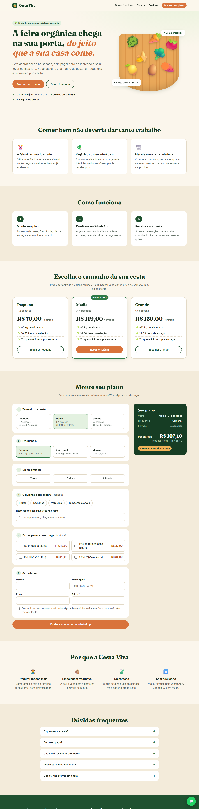
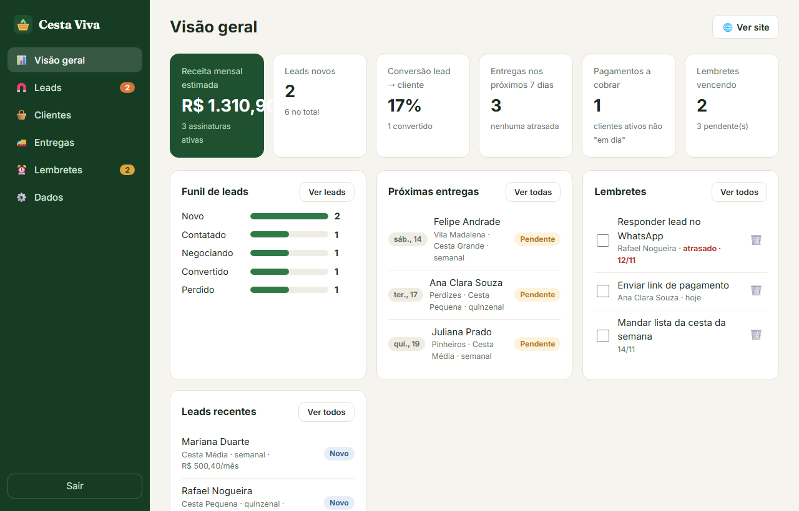
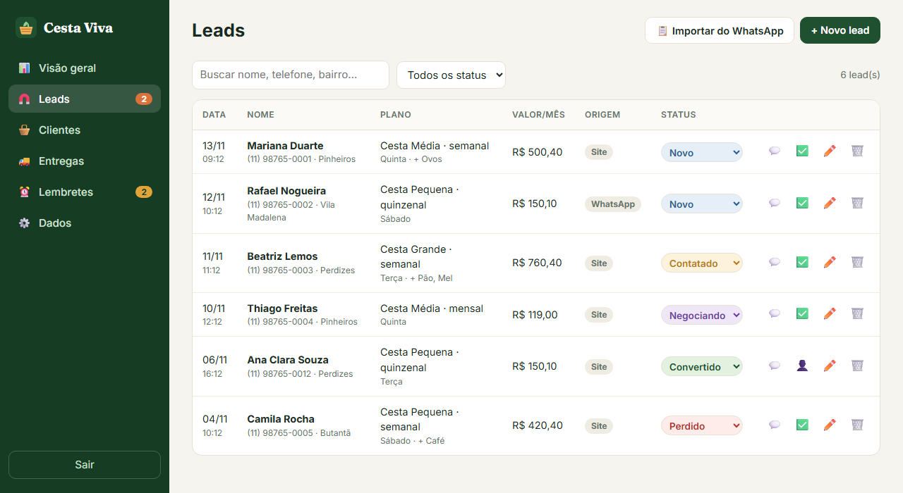
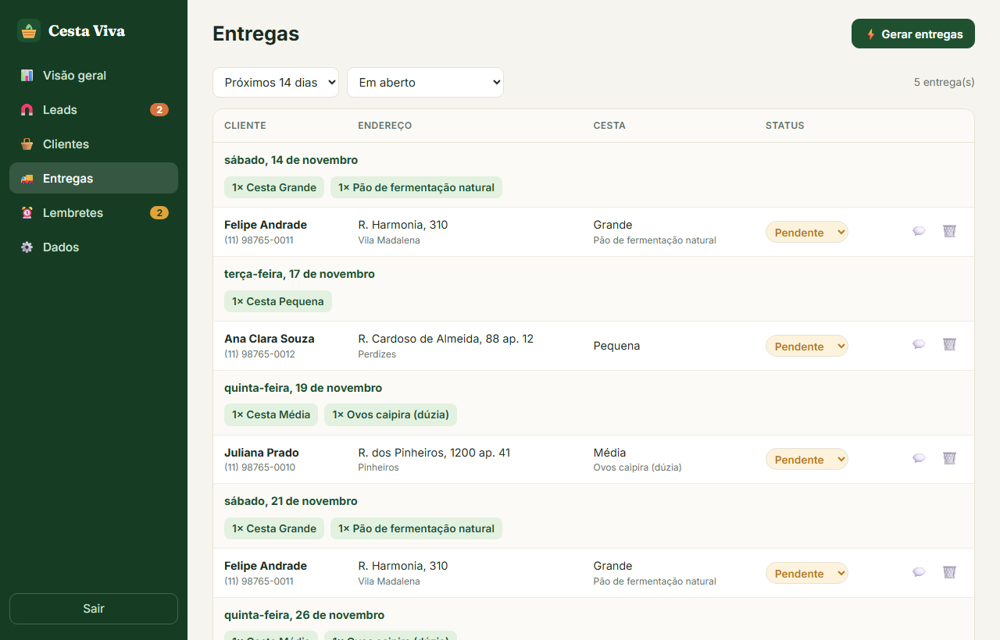
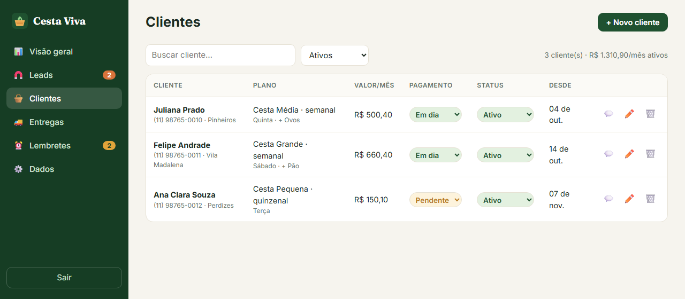
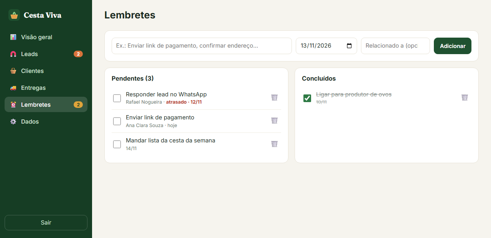
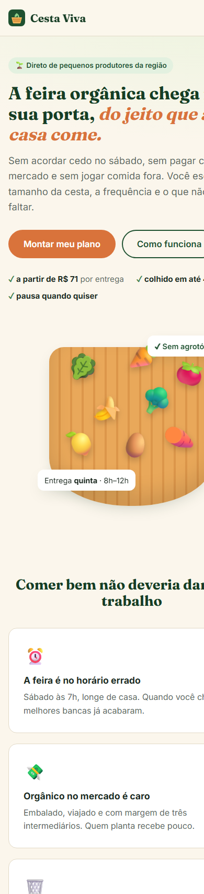

# 🧺 Cesta Viva — MVP de assinatura de orgânicos

> Feira orgânica de pequenos produtores entregue em casa, por assinatura.
> MVP feito com **HTML, CSS e JavaScript puros**, sem framework, sem build e sem banco de dados próprio.

**🔗 Aplicação publicada:** https://alanmsilva94.github.io/cesta-viva/ · **Repositório:** https://github.com/alanmsilva94/cesta-viva



---

## 1. A dor escolhida

Comprar orgânicos frescos com uma rotina corrida é difícil:

| Problema | Na prática |
|---|---|
| ⏰ **A feira é no horário errado** | Sábado às 7h, longe de casa. Quem chega tarde encontra as bancas vazias. |
| 💸 **Orgânico no mercado é caro** | Embalado, transportado de longe e com vários intermediários. O produtor recebe pouco. |
| 🗑️ **Desperdício** | Sem planejamento, a compra vira impulso e parte estraga na geladeira. |

**Por que vale um negócio:** o problema é **recorrente** (toda semana), o ticket é **previsível** e a assinatura resolve as três dores ao mesmo tempo: entrega na porta, preço sem atravessador e quantidade certa para o tamanho da casa. Receita recorrente também facilita planejar a compra junto aos produtores, o que reduz o desperdício no próprio negócio.

Ideias comparadas antes de escolher:

| Ideia | Frequência da dor | Disposição a pagar | Dá para testar manual? | Escolha |
|---|---|---|---|---|
| Organizador de séries/streamings | Alta | Baixa (há apps grátis) | Sim | ❌ |
| Lembrete de manutenção do carro | Baixa | Média | Sim | ❌ |
| **Assinatura de cesta orgânica** | **Semanal** | **Média/alta** | **Sim (WhatsApp + entrega própria)** | ✅ |

---

## 2. Tamanho de mercado (TAM · SAM · SOM)

> ⚠️ **Estimativa didática, não pesquisa de mercado.** Os números abaixo são **premissas** para montar o raciocínio. Antes de usar em um pitch, troque cada uma por dados da sua cidade (IBGE, Organis, prefeitura, associações de produtores).

Método *bottom-up*, a partir de uma cidade grande hipotética:

| Camada | Premissa | Cálculo | Resultado |
|---|---|---|---|
| **TAM**: domicílios da cidade que compram orgânicos com regularidade | 1.000.000 domicílios × 15% compram orgânicos × R$ 300/mês | 150.000 × R$ 300 × 12 | **≈ R$ 540 mi/ano** |
| **SAM**: região atendível pela logística própria (8 bairros) | 10% do TAM | 15.000 domicílios × R$ 300 × 12 | **≈ R$ 54 mi/ano** |
| **SOM**: o que dá para conquistar em 12 meses | 1% do SAM | 150 assinantes × R$ 300 × 12 | **≈ R$ 540 mil/ano** |

O SOM é o número que importa para o MVP: **150 assinantes ativos** com ticket médio de ~R$ 300/mês. O painel acompanha exatamente isso (KPI *Receita mensal estimada*).

---

## 3. Business Model Canvas

| Bloco | Cesta Viva |
|---|---|
| **Segmentos de clientes** | Famílias e casais de 25–50 anos, com rotina corrida, que já compram ou querem comprar orgânicos; moradores de bairros próximos ao centro de distribuição. |
| **Proposta de valor** | Orgânicos da estação, colhidos em até 48h, entregues na porta, com tamanho e frequência sob medida e sem fidelidade. |
| **Canais** | Landing page → formulário "Monte seu plano" → **WhatsApp** (onde a venda fecha). Divulgação em grupos de bairro e Instagram. |
| **Relacionamento** | Pessoal pelo WhatsApp: lista da cesta na véspera, troca de até 2 itens, pausa quando viajar. |
| **Fontes de receita** | Assinatura por entrega (semanal −10%, quinzenal −5%, mensal) + extras recorrentes (ovos, pão, mel, café). |
| **Recursos-chave** | Rede de produtores, espaço de separação, veículo de entrega, número de WhatsApp, painel de gestão. |
| **Atividades-chave** | Compra com produtores, montagem das cestas, rota de entrega, atendimento e cobrança. |
| **Parcerias-chave** | Famílias agricultoras e cooperativas, padaria artesanal, apicultor, torrefação local. |
| **Estrutura de custos** | Produtos (≈ 55%), embalagem retornável, combustível/entregador, taxas do link de pagamento, divulgação. |

---

## 4. A tese que o MVP testa

> **"Famílias com rotina corrida assinam uma cesta de orgânicos personalizada se a contratação for simples e a conversa for pelo WhatsApp."**

Hipóteses e como o MVP mede cada uma:

| # | Hipótese | Métrica no painel | Critério de sucesso (sugestão) |
|---|---|---|---|
| H1 | As pessoas querem montar o próprio plano | Leads vindos do site | ≥ 30 leads no 1º mês |
| H2 | Quem monta o plano fecha a assinatura | Conversão lead → cliente (KPI) | ≥ 25% |
| H3 | A assinatura se mantém | Clientes ativos × pausados/cancelados | ≥ 70% ativos após 2 meses |
| H4 | Extras aumentam o ticket | Lista de separação (extras por entrega) | ≥ 30% dos clientes com 1 extra |

### O que ficou manual de propósito

| Manual agora | Por quê | Quando automatizar |
|---|---|---|
| **Fechamento da venda pelo WhatsApp** | A conversa ensina o que o cliente valoriza e quais objeções aparecem. | Quando o roteiro de venda estiver estável. |
| **Link de pagamento enviado à mão** (botão 💬 "Cobrar" no cliente) | Evita integrar gateway antes de saber se alguém paga. | Stripe/Mercado Pago depois de ~50 assinantes. |
| **Dados no navegador (localStorage)** | Zero custo e zero configuração; backup em JSON/CSV. | Supabase/Firebase quando houver mais de uma pessoa operando. |
| **Lead do site chega pelo WhatsApp** e entra no painel com *Importar do WhatsApp* | Não exige servidor; a mensagem já vem estruturada. | Webhook (`leadWebhookUrl`) + n8n quando o volume crescer. |
| **Rota de entrega** | Com poucos clientes, ordenar por bairro basta (a lista já vem ordenada assim). | Roteirizador quando houver mais de 30 entregas/dia. |
| **Login por PIN local** | Só uma pessoa usa o painel, em um navegador. | Autenticação real junto com o back-end. |

---

## 5. O que o MVP tem

### Fluxo do cliente
1. **Landing page** com a dor, como funciona, planos, benefícios e FAQ.
2. **Monte seu plano:** tamanho da cesta, frequência, dia de entrega, preferências, restrições e extras, com **resumo e preço ao vivo** (incluindo a economia mensal).
3. **Validação** de campos (WhatsApp com DDD, e-mail opcional, aceite de contato, conforme a LGPD).
4. **WhatsApp com os dados do formulário no corpo da mensagem**, pronta para enviar.

### Painel de administração (`admin.html`)
| Tela | Funções |
|---|---|
| **Visão geral** | Receita mensal estimada, leads novos, conversão, entregas da semana, pagamentos a cobrar, lembretes; funil de leads. |
| **Leads** | Busca, filtro por status, mudança de status, resposta no WhatsApp, **converter em cliente sem redigitar**, **importar lead colando a mensagem do WhatsApp**. |
| **Clientes** | Plano, valor mensal, pagamento (pendente/em dia/atrasado), status (ativo/pausado/cancelado), cobrança pelo WhatsApp. |
| **Entregas** | **Gera a agenda automaticamente** respeitando dia e frequência (semanal/quinzenal/mensal), agrupada por data, com **lista de separação** (quantas cestas de cada tamanho e quais extras) e aviso "saiu para entrega" no WhatsApp. |
| **Lembretes** | Criação com data e pessoa relacionada; atrasados em destaque. Lembretes automáticos ao chegar lead e ao converter cliente. |
| **Dados** | Backup/restauração JSON, exportação CSV (Excel/Sheets), dados de exemplo, redefinir PIN, apagar tudo. |

### Telas

| Visão geral | Leads |
|---|---|
|  |  |

| Entregas com lista de separação | Clientes |
|---|---|
|  |  |

| Lembretes | Landing no celular |
|---|---|
|  |  |

---

## 6. O mega prompt

O desafio original usa ChatGPT + Lovable. Aqui a construção foi feita **à mão em HTML/CSS/JS**, com IA como co-founder. Este é o prompt-especificação usado como base:

````markdown
# Projeto: Cesta Viva — MVP de assinatura de cestas orgânicas

## Contexto
Negócio de assinatura de cestas de orgânicos de pequenos produtores locais.
Tese: famílias com rotina corrida assinam se a contratação for simples e a venda
fechar no WhatsApp. Pagamento e marketplace ficam FORA do MVP.

## Stack e restrições
- HTML, CSS e JavaScript puros. Sem framework, sem build, sem banco próprio.
- Dados no localStorage; backup em JSON e exportação CSV.
- Publicável no GitHub Pages. Nenhuma chave ou senha no código.
- Responsivo (mobile first), acessível (labels, foco visível, aria-live).

## Identidade visual
- Verde-floresta #1f5130 (primária), creme #fbf6ec (fundo), terracota #d9733b (CTA),
  verde WhatsApp #25d366.
- Títulos em Fraunces (serifa), texto em Inter. Tom de voz próximo e direto.

## Fluxo do cliente (index.html)
1. Hero com a promessa + CTA "Montar meu plano".
2. Seção da dor (horário da feira, preço, desperdício) e "Como funciona" em 3 passos.
3. Cards de planos: Pequena (1–2 pessoas, R$ 79), Média (3–4, R$ 119, destaque),
   Grande (5+, R$ 159) por entrega.
4. Formulário "Monte seu plano": tamanho, frequência (semanal −10%, quinzenal −5%,
   mensal), dia (ter/qui/sáb), preferências, restrições, extras (ovos, pão, mel, café),
   nome, WhatsApp, e-mail, bairro, aceite LGPD.
5. Resumo lateral com preço por entrega, estimativa mensal e economia.
6. Ao enviar: salvar lead, abrir o WhatsApp com TODOS os dados na mensagem
   (formato "Rótulo: valor" por linha) e mostrar tela de sucesso.
7. FAQ e botão flutuante de WhatsApp.

## Painel (admin.html)
- Acesso por PIN criado no primeiro uso (hash SHA-256 no navegador).
- Visão geral: receita mensal, leads novos, conversão, entregas em 7 dias,
  pagamentos a cobrar, lembretes vencendo, funil.
- Leads: busca, filtro, status, WhatsApp, converter em cliente (copia os dados e cria
  lembrete "Enviar link de pagamento"), importar lead colando a mensagem do WhatsApp.
- Clientes: plano, valor, pagamento, status, cobrança pelo WhatsApp.
- Entregas: gerar agenda dos próximos 14 dias respeitando a frequência, agrupar por
  data, lista de separação por tamanho e extras, status e aviso pelo WhatsApp.
- Lembretes: CRUD com data; atrasados em vermelho.
- Dados: exportar/importar JSON, CSV, dados de exemplo, apagar tudo.
````

### Correções pedidas depois de testar como cliente

Rodada de testes: usei o site como cliente (pedido completo), depois o painel como operador (conversão, importação, geração de entregas) em desktop e celular. O que falhou e foi corrigido:

| # | Problema encontrado | Correção |
|---|---|---|
| 1 | Depois de enviar o pedido, o formulário **continuava aparecendo** junto com a tela de sucesso (`display: grid` sobrepunha o atributo `hidden`). | Regra global `[hidden] { display: none !important; }`. |
| 2 | Leads feitos à noite apareciam com a **data do dia seguinte** (a data era lida em UTC). | `formatDate` converte timestamps para o fuso local. |
| 3 | Leads importados/cadastrados ficavam **fora da ordem cronológica**. | Lista e "Leads recentes" ordenados por data de criação. |
| 4 | KPI "Lembretes para hoje" contava também os atrasados. | Renomeado para "Lembretes vencendo". |
| 5 | Botões "Cancelar" dos modais disparavam a validação de campos obrigatórios. | `formNoValidate` nos botões de cancelar. |
| 6 | No celular os KPIs ocupavam uma coluna cada, com a tela muito longa. | Grade com mínimo de 150px (2 colunas no celular). |

Prompt único de correções (modelo para as próximas rodadas):

```markdown
Testei a aplicação como cliente e como administrador. Corrija SOMENTE os itens abaixo,
sem alterar layout, cores ou textos que não foram citados. Antes de mudar, liste o plano
de alterações por arquivo.
1. [tela] — [o que fiz] — [o que aconteceu] — [o que eu esperava]
2. ...
Critério de pronto: refaço o mesmo passo e o resultado esperado acontece, sem erros no console.
```

---

## 7. Como rodar e configurar

Não tem instalação. Abra o `index.html` no navegador, ou sirva a pasta:

```bash
python -m http.server 5500
```

Depois acesse `http://localhost:5500` (site) e `http://localhost:5500/admin.html` (painel).

**Antes de publicar, edite [`js/shared.js`](js/shared.js):**

```js
const CONFIG = {
  brand: 'Cesta Viva',
  whatsapp: '5500000000000', // ← seu número: DDI + DDD + número
  leadWebhookUrl: '',        // opcional: Google Apps Script / n8n / Make
  sizes: [...], frequencies: [...], extras: [...], days: [...],
};
```

Preços, tamanhos, extras e dias de entrega são lidos desse objeto: mude ali e o site e o painel se ajustam.

> **Importante sobre os dados:** o painel lê o `localStorage` **do navegador onde está aberto**. Um pedido feito pelo celular do cliente chega para você **pelo WhatsApp**; use **Leads → Importar do WhatsApp** e cole a mensagem para registrá-lo. Para centralizar automaticamente, configure o `leadWebhookUrl`.

## 🚀 Como publicar

1. Crie um repositório **público** chamado `cesta-viva` (minúsculas, sem acento) e envie os arquivos.
2. No GitHub: **Settings → Pages → Source: Deploy from a branch → `main` / root**.
3. Em 1–2 minutos o site fica em `https://SEU-USUARIO.github.io/cesta-viva/`. Atualize o link no topo deste README.

## 📁 Estrutura

```
cesta-viva/
├── index.html            # landing page + formulário "Monte seu plano"
├── admin.html            # painel de administração
├── css/
│   ├── style.css         # estilos da landing
│   └── admin.css         # estilos do painel
├── js/
│   ├── shared.js         # CONFIG, preços, mensagem/leitura do WhatsApp, utilidades
│   ├── store.js          # persistência no localStorage
│   ├── app.js            # lógica da landing e do formulário
│   └── admin.js          # lógica do painel
├── assets/favicon.svg
└── docs/screenshots/     # prints usados neste README
```

## 🔒 Segurança

- Nenhuma chave, token ou senha versionada. O PIN do painel é criado no primeiro acesso e guardado **só como hash** no navegador.
- O PIN é uma barreira simples, **não** substitui autenticação: não guarde dados sensíveis (CPF, cartão) no painel.
- Todo texto digitado é escapado antes de ir para a tela (proteção contra XSS).
- `admin.html` tem `noindex` para não aparecer em buscadores.

## 🌱 Próximos passos

- [ ] Alerta de novo lead por e-mail (Resend via webhook, com a chave **fora** do repositório)
- [ ] Pagamento recorrente pelo Stripe/Mercado Pago
- [ ] Back-end (Supabase) para vários operadores e dispositivos
- [ ] Chatbot no WhatsApp com n8n para confirmar pedidos
- [ ] Manual da marca em PDF
